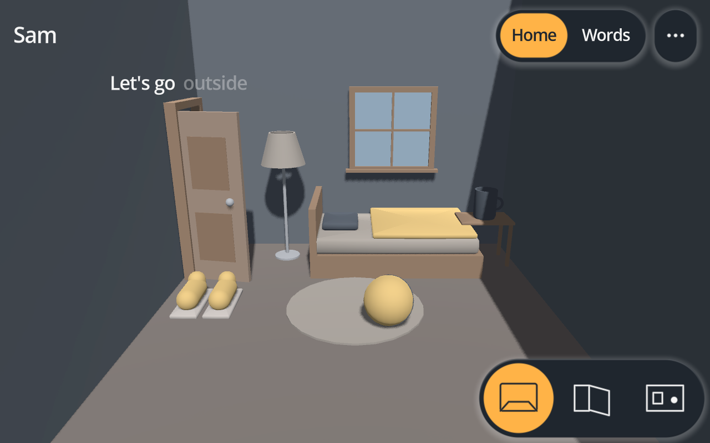
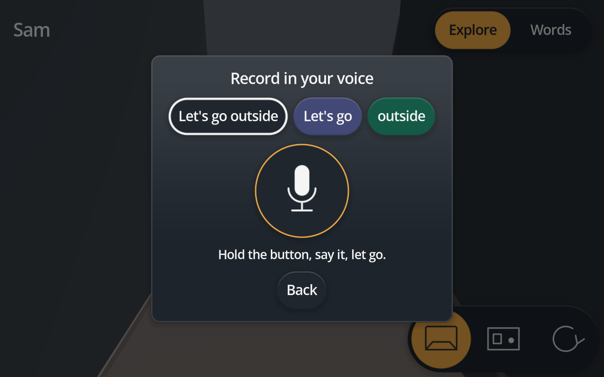

# Alex

A room to explore, that speaks in voices you love.

Alex Language EXplorer is a small app for children who acquire language in whole chunks: autistic
children, children with developmental delays, and any child whose first speech is echolalia. It is not a
clinical tool and not a substitute for one. It is something a learner can pick up and discover on their own,
after a caregiver spends a few minutes setting it up.



## What the learner sees

A bedroom. A door, a lamp, a window, a bed, a cup on the nightstand, a rug, a ball, a pair of shoes by the
door. Touch the door and it swings open as a familiar voice says "Let's go outside." Touch it again and it
closes: "Let's go inside." The lamp lights, the ball bounces, the cup wobbles. While each phrase plays, its chunks float above the object and light
up one after another, so the learner sees where a phrase comes apart without being told.

Two pills at the top switch between Explore, the room, and Words, a column of phrase tiles. Three buttons
under the room look at it from the front, the side and above. A caregiver can add a fourth that
turns the room, or take all of them away. Whatever the learner does with them, the room comes back to the front
on its own.

There are no questions, no right answers, no scores, no timers and no rewards. Touching the same thing forty
times is fine. Nothing on the learner's screen can delete anything, buy anything, or leave the device.

## What a caregiver does

1. **Make a profile.** A name, a starter pack, a look. One minute.
2. **Record the phrases in your own voice.** Hold any object for two seconds, hold the big button, say the
   phrase, let go, hear it back, keep it. Until you do, the device's own voice fills in.
3. **Record the name.** Hold the profile name to record it; tap the name to hear it.
4. **Hand it over.**



To permanently remove a profile and all its recordings, choose **Edit** in the profile picker and hold
**Hold 3 seconds to delete**. There is no undo.

New recordings get local noise reduction, quiet-end trimming, and volume balancing before preview.

Everything stays on the device. There is no account, no network and no analytics.

## Why it is built this way

Echolalia is communication, not noise. Repeated phrases carry requests, protests, turn-taking and
self-regulation [[1]](#research), [[2]](#research). Questions and demands draw more echoing and less original
speech from autistic children than comments do, which is why the app asks nothing and only offers
[[3]](#research). Whether echolalia should be reduced at all is contested, and the reviews find little evidence
for the interventions that try [[4]](#research), [[5]](#research). Alex does not try: it plays the learner's
phrases back in familiar voices, attached to things they can act on, and lets repetition run.

The phrases ship in chunks an adult can recombine ("Let's go" + "outside", "Let's go" + "in the car"). That idea
comes from the Natural Language Acquisition framework [[6]](#research), [[7]](#research), which describes
language growing from whole gestalts to flexible sentences. The framework's clinical claims are debated and its
protocol has no empirical evaluation yet [[8]](#research), [[9]](#research), [[10]](#research). Alex uses the
chunking as a design heuristic for making seams visible, not as a treatment, and nothing in the app depends on
the stage model being right. The thinking, and the rules that follow from it, are in
[`docs/design.md`](docs/design.md).

Nothing about one child is in the code. A profile, a starter pack and a style preset carry everything, so one
install serves a family, a classroom or a caseload ([`docs/profiles.md`](docs/profiles.md)).

## Status

Early and usable. One 3D room with nine objects, a plain board for phrases with no object, three looks, and
recording in your own voice. Coming: more rooms and reactions, the learner's own songs and clips, a remix board
that offers chunk beginnings beside chunk endings, and a bank view for caregivers. Exports for Android and iOS
phones and tablets, macOS, Windows and Linux. Runs on an iPhone; recording there is not yet tried.

## For developers

**Godot 4.7**, GDScript only, strict typing promoted to errors. Organized around a `justfile`.

```sh
git lfs pull   # application artwork
just setup     # the import pass that registers every class; run once after cloning
just editor    # open the project
just run       # profile picker, then the room
just lint      # headless project load; fails on script errors
just test      # the unit suites, about a second
just check     # doc caps, lint, tests, the room probe
```

Godot is found through `GODOT_BIN`, then `godot` on PATH, then `/Applications/Godot.app` on macOS.
[`docs/dev-setup.md`](docs/dev-setup.md) has the rest, including the Claude Code hook and MCP servers.

| Path | Holds |
| --- | --- |
| `scenes/` | `main.tscn`, the adults' `ui/profile_picker.tscn` and `ui/record_overlay.tscn`, the learner's `child/home.tscn`, `child/room_view.tscn` and `child/gestalt_tile.tscn`. |
| `scripts/profiles/` | The data model: `Profile`, `Gestalt`, `Room`, `Spot`, `Board`, `NlaStage`, `Starter`, `JsonValue`, `ProfileRepo`, the `ProfileStore` autoload. |
| `scripts/style/` | `StylePreset` (a resource) and the `Style` autoload that turns one into a Theme. |
| `scripts/speech/` | `Speaker` (a recording, else OS text to speech) and `Recorder` (the microphone). |
| `scripts/geometry/` | Objects as recipes and the camera math: `Sdf`, `Mesher`, `Primitive`, `Recipe`, `RecipeBuilder`, `ObjectRecipes`, `Picker`, `CameraFraming`, `RoomSpace`. |
| `scripts/child/` | The learner's screens: `ChildHome`, `RoomView`, `SpotBody`, `ViewWidget`, `GestaltTile`. |
| `scripts/ui/` | Adult-facing screens and the field-drawn controls: `ProfilePicker`, `RecordOverlay`, `SdfShape`, `SdfGlyph`, `SdfButton`, `SdfPanel`, `PillBar`, `HoldButton`, `UiGeometry`. |
| `shaders/ui/` | `shape.gdshader` and `glyph.gdshader`, the two fields every control is drawn from. |
| `starters/` | Starter packs as JSON. `blank` and `home_routines` ship. |
| `styles/` | Style presets as `.tres`. `calm`, `bold` and `quiet` ship. |
| `tests/unit/` | Hand-rolled suites, one per pure class. `tools/instr/` holds the scene probes. |
| `docs/` | [`design.md`](docs/design.md), [`geometry.md`](docs/geometry.md), [`ui.md`](docs/ui.md), [`profiles.md`](docs/profiles.md), [`dev-setup.md`](docs/dev-setup.md), [`gates.md`](docs/gates.md), [`exports.md`](docs/exports.md). |

`CLAUDE.md` carries the durable rules for anyone, person or agent, working in the repository. This README is
capped at 16 kB by `tools/check-doc-size.sh`; depth lives in `docs/`.

### Adding a room

A room is JSON in a starter pack: spots with a `kind` (what it looks like), a `reaction` (what it does), a
wall or a place on the floor, a size, and the gestalt it says. No art is needed; every kind is built from
primitives the way the thing is made, with a distance field as its twin for picking and, later, editing
([`docs/geometry.md`](docs/geometry.md)). The fields are listed in [`docs/profiles.md`](docs/profiles.md). A
new kind of object is a `Spot.Kind` value and a recipe function in `ObjectRecipes`.

### Exports

```sh
just export-android   # one preset into build/<commit>/android/; also -ios, -macos, -windows, -linux
just exports          # every preset, then check what each export holds
just run-ios          # export iOS and run it on the paired iPhone or iPad
just testflight       # export iOS, archive it and upload it for TestFlight
```

Each needs the Godot export templates of the same version. Android also needs a JDK and an Android SDK, and iOS
needs Xcode and an Apple Developer Team ID. [`docs/exports.md`](docs/exports.md) has the setup, the signing and
the checks.

## Research

What the claims above rest on. Peer-reviewed unless noted. The debate in 8 to 10 is live, and a reader deciding
how much weight to give the stage model should read both sides.

1. Prizant, B. M., & Duchan, J. F. (1981). The functions of immediate echolalia in autistic children. *Journal
   of Speech and Hearing Disorders*, 46(3), 241–249. [doi:10.1044/jshd.4603.241](https://doi.org/10.1044/jshd.4603.241)
2. Prizant, B. M., & Rydell, P. J. (1984). Analysis of functions of delayed echolalia in autistic children.
   *Journal of Speech and Hearing Research*, 27(2), 183–192. [doi:10.1044/jshr.2702.183](https://doi.org/10.1044/jshr.2702.183)
3. Rydell, P. J., & Mirenda, P. (1994). Effects of high and low constraint utterances on the production of
   immediate and delayed echolalia in young children with autism. *Journal of Autism and Developmental
   Disorders*, 24(6), 719–735. [doi:10.1007/BF02172282](https://doi.org/10.1007/BF02172282)
4. Blackburn, C., Tueres, M., Sandanayake, N., Roberts, J., & Sutherland, R. (2023). A systematic review of
   interventions for echolalia in autistic children. *International Journal of Language & Communication
   Disorders*, 58(6), 1977–1993. [doi:10.1111/1460-6984.12931](https://doi.org/10.1111/1460-6984.12931)
5. Cohn, E. G., McVilly, K. R., Harrison, M. J., & Stiegler, L. N. (2022). Repeating purposefully: Empowering
   educators with functional communication models of echolalia in autism. *Autism & Developmental Language
   Impairments*, 7. [doi:10.1177/23969415221091928](https://doi.org/10.1177/23969415221091928)
6. Peters, A. M. (1983). *The Units of Language Acquisition.* Cambridge University Press. The source of the
   gestalt versus analytic distinction in typical language development.
7. Blanc, M. (2012). *Natural Language Acquisition on the Autism Spectrum: The Journey from Echolalia to
   Self-Generated Language.* Communication Development Center. Not peer-reviewed; the origin of the six stages.
8. Haydock, A., Harrison, L., Baldwin, K., & Leadbitter, K. (2024). Embracing gestalt language development as a
   fundamental neurodiversity-affirmative practice. *Autism*, 28(5), 1055–1059.
   [doi:10.1177/13623613241234598](https://doi.org/10.1177/13623613241234598). For the framework; see the
   response by Venker and Lorang (2025) in the same journal, [doi:10.1177/13623613241287577](https://doi.org/10.1177/13623613241287577).
9. Hutchins, T. L., Knox, S. E., & Fletcher, E. C. (2024). Natural language acquisition and gestalt language
   processing: A critical analysis of their application to autism and speech language therapy. *Autism &
   Developmental Language Impairments*, 9. Against the framework's theoretical footing.
10. Bryant, L., Bowen, C., Grove, R., Dixon, G., Beals, K., Shane, H., & Hemsley, B. (2024). Systematic review
    of interventions based on gestalt language processing and natural language acquisition (GLP/NLA): Clinical
    implications of absence of evidence and cautions for clinicians and parents. *Current Developmental
    Disorders Reports*, 12(2). [doi:10.1007/s40474-024-00312-z](https://doi.org/10.1007/s40474-024-00312-z).
    Found no empirical study of the protocol's effectiveness.
11. Stiegler, L. N. (2015). Examining the echolalia literature: Where do speech-language pathologists stand?
    *American Journal of Speech-Language Pathology*, 24(4), 750–762.
    [doi:10.1044/2015_AJSLP-14-0166](https://doi.org/10.1044/2015_AJSLP-14-0166). A survey of the disagreements.

## License

**MIT OR Apache-2.0**, at your option. See [LICENSE](LICENSE). Contributions are dual-licensed the same way.
Inbound equals outbound; no CLA.
