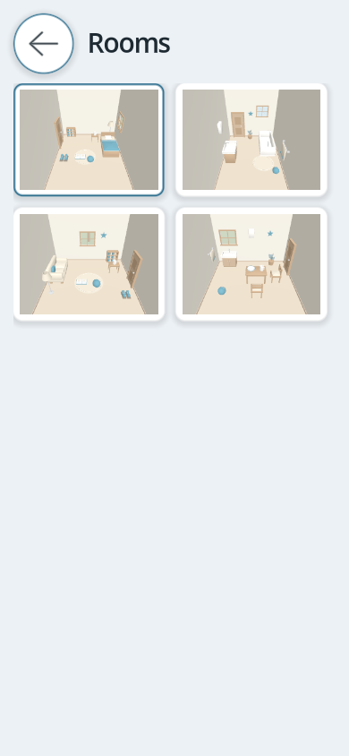
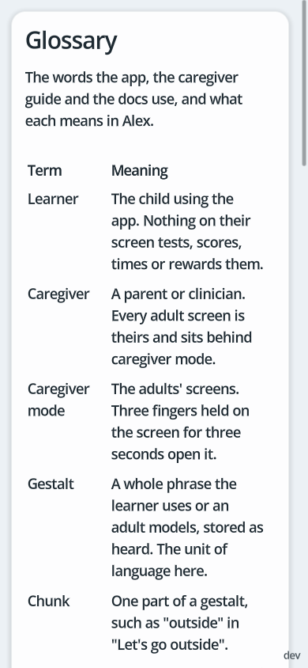

# Screen-space graphics

Everything drawn on the screen that is not the 3D room is a distance field: every button, panel, tile and bar
is `shaders/ui/shape.gdshader`, every icon is `shaders/ui/glyph.gdshader`, and text is the default font
rendered as a multichannel distance field (`gui/theme/default_font_multichannel_signed_distance_field`). No
StyleBoxFlat is drawn anywhere a user looks, and no image is loaded.

## Mobile typography

- `Typography` defines logical point/dp sizes. `Style` converts them to canvas units before rendering.
- iOS uses the display scale. Android uses `densityDpi / 160`. Desktop windows use one logical unit per pixel.
- The layout canvas has a minimum short side of 640 units after density conversion. Rotation preserves the type size.
- The default body is 17 points. This follows [Apple’s iOS default](https://developer.apple.com/design/human-interface-guidelines/accessibility) and the hierarchy of [Material 3 typography](https://developer.android.com/develop/ui/compose/designsystems/material3).

| Role | Logical size |
| --- | --- |
| Page title | 28 |
| Section heading | 22 |
| Body and controls | 17 |
| Supporting text | 15 |
| Build stamp | 12 |
| Learner phrases | 22 |
| Spoken caption and Build strip | 24 |

- Preset font multipliers remain: Calm 1.0, Bold 1.15, Quiet 1.1.
- Caregiver **Text size** offers 100%, 125%, 150% and 200%. Selection applies immediately and persists in `user://accessibility.cfg` for every profile on the device.
- This is an app text-size preference. It does not yet follow iOS Dynamic Type or Android’s system font-size setting.
- Text enlargement updates the theme, phrase pills and open Markdown pages without resetting learner state.
- Phrase pills and forms wrap and grow. Markdown headings never fall below body size; line spacing and emphasis scale with text.
- `just typography-probe` checks all presets at 100% and 200% on a logical phone, a 3× phone in both orientations and a 2× tablet. It covers learner modes, captions, room selection, recording, profile forms and all Markdown pages.

## Why a field

A field is evaluated per pixel, so an edge covers exactly its share of every pixel it crosses at every size and
scale, and a stroke thinner than a pixel draws at its own coverage instead of being floored up to one. The
coverage law is the one spaceman's HUD uses: `clamp(0.5 - sd / fw, 0, 1)` against the pixel's footprint. The
rim and the shadow are the same field read at an offset, not extra geometry.

## The geometry language

The shapes follow where platform interfaces have moved: rounded, concentric and floating. Three rules, all in
`UiGeometry` and pure:

- **Concentric corners.** A control inside a bar or a panel takes the outer radius minus the padding between
  them (`UiGeometry.concentric`), so the two curves share a center.
- **Pills.** A bar and the buttons in it are pills: the radius is half the shorter side.
- **Relief.** Every shape stands off the screen by a lit rim at its top edge and a soft shadow below. The
  style preset's `relief` scales both; `quiet` is nearly flat. Translucency and refraction are left out on
  purpose: they cost contrast, and contrast is what a learner with a visual or motor difference needs most.

## Floating over the room

The room renders edge to edge, and the chrome floats over it: the title, the mode strip and the profiles
button at the top, the view pill at the bottom right. The camera frames the room's objects into the band the
floating controls leave (`RoomView.safe_rect`, `CameraFraming.points_extent`, `CameraFraming.center_offset`),
so the walls may run under a control and an object never does. The frame includes each object's bounds and the floor footprint. Perspective depth and the camera offset are included in the fit.
`just room-probe` checks the full bounds inside the band.

Containers above the room are `MOUSE_FILTER_IGNORE`, so a tap between controls reaches the room; a pill bar
is `PASS`, so a tap on its padding does not.

## The mode strip

- The learner's strip has two pills, Explore and Words, in that order.
- Explore starts in the entry scene's room (docs/profiles.md "The entry scene"). Returning from Words restores the room chosen during this session.
- Words shows the whole bank: the boards' phrases first, in board order, then the rest in bank order
  (`Profile.words_gestalts`). A room's phrases are in the bank, so they are in Words.
- A mode with nothing to show has no pill. With one pill, the strip hides.
- Room and board titles stay in profile data and never reach the learner's screen.
- A profile with multiple rooms shows a rooms glyph opposite the camera controls. A single-room profile hides it.
- The glyph opens a full-screen chooser with large procedural room previews in saved order. The current room has an accent border. Back returns without changing rooms.
- Preview taps enter the room; preview drags scroll the chooser. Room names are available to assistive technology without visible labels.
- Each room retains its object toggles, last-spoken phrases for recording, and camera position across switching and Words. Returning does not replay speech or reactions.
- Room state lasts until the profile is opened again. No schema change or disk writes are needed.
- Previews render once after layout and are freed when the chooser closes. Only the active room keeps rendering.
- `just room-switch-probe` checks native taps and drags, state restoration, scene stages, and safe areas in every style at phone and tablet sizes.

## Words

Words has two modes on a glyph widget floating at the bottom right, like the room's view widget
(`WordsWidget`, a `GlyphBar`). The columns under it leave its height clear, so their last row scrolls above
it. Words reopens in the mode the learner last used.

- **Palette** is every phrase in the bank as a tile in a scrolling column. Tap says it. Hold records it.
- **Build** is a strip and two columns (`BuildView`). The left column holds the bank's beginnings, the first
  chunk of every phrase; the right holds its endings, every later chunk; each once by its color key
  (`ChunkBank`). Every chunk is a `ChunkButton` in its own color, at the tile floor.
- A tap on a chunk lands it on the strip and says it. A tap on the strip says the whole. A tap on a chunk in
  the strip takes it off. There is no send button and no clear button.
- A strip that says a phrase the bank holds is that phrase (`ChunkBank.find`), so it plays in the
  caregiver's voice. Any other strip is said chunk by chunk, each from its take or by the OS voice
  (docs/profiles.md "Recordings").
- A chunk landing on the strip plays its take, or the bank's own one-chunk phrase, or the OS voice.
- Hold a chunk to record that chunk. Hold the strip to record what it says.
- The strip keeps what the learner built until they change it, across Explore and back.
- The chunks the bank says next carry a border (`ChunkBank.leads`, `ChunkButton.lead`). See "Build with
  longer phrases".

### Build with longer phrases

Build serves a phrase of any length with the same two columns. The layout rule, by bank shape:

| Bank | Left column | Right column | Bordered |
| --- | --- | --- | --- |
| Two-chunk phrases (stages 1 and 2) | Every first chunk | Every second chunk | On an empty strip, the left column. After a chunk lands, the chunks that follow it in some phrase. |
| Longer phrases (stages 3 and 4) | Every first chunk | Every middle and last chunk, each once | The same rule. After `I` lands in the kitchen pack, `want`, `am`, `see` and `have` carry the border. |
| Any mix | The union | The union | The same rule. |

- **The border is the only cue.** A bordered chunk is one the bank says next after the strip's last chunk
  (`ChunkBank.next`). Nothing moves, nothing dims, and every chunk stays tappable. A finished phrase borders
  nothing. The border is in the style's text color at `ChunkButton.LEAD_BORDER_PX`, because the quiet
  preset's relief is near flat and a relief cue would vanish there.
- **Two columns is the ceiling.** A phone at the 160 px floor holds two columns. A column per position would
  also show one chunk several times, since a chunk's position varies across phrases.
- **Positions stay put.** A column is in bank order and never reorders after a tap. A chunk that both starts
  a phrase and follows one appears in both columns.
- **The strip wraps and never reorders.** A tap on a strip chunk takes it off. Insertion is remove and
  re-add. A drag would collide with the press rules.
- **A strip is said as the bank says it.** A strip that spells a bank phrase plays its recording, whatever
  its bars. Any other strip is said chunk by chunk.
- **The pool is measured, not filtered.** `just layout-probe` loads every shipped scene into one bank on a
  phone and prints the column sizes as `BUILD-LONG`. Words stays the whole bank. A filter or a category
  would be a thing the learner has to understand. Scrolling the right column to the first bordered chunk
  is #66.

| Bank | Beginnings | Endings | Right column on a phone |
| --- | --- | --- | --- |
| `home_routines` alone | 28 | 32 | 6 screens |
| `snack_time` alone | 26 | 35 | 6 screens |
| Every shipped scene | 65 | 77 | 14 screens |

- **Build and the layout editor share the composition model and nothing else.** An object is a union of
  primitives with authored seams, a room is a layout of objects, and a sentence is a union of chunks with
  authored seams. Whether a learner can move an object so the room says the relation is #65.

## Chunk colors

- Every chunk has one color, keyed by its text. "Let's go" is the same color on every tile, caption and pack.
- The key is the chunk lowercased and trimmed.
- `ChunkColors` hashes the key into the style preset's `chunk_palette`. The hash is FNV-1a with the murmur3
  finalizer, 32 bits, pinned in `chunk_colors_test.gd`.
- Two chunks can share a color, about one pair in ten with a 10-color palette. A large bank makes that certain.
- The color fills a pill behind the chunk. The text keeps the preset's text color.
- Every palette color carries the text at 4.5:1 or better, at rest and brightened (`style_preset_test.gd`).
- A color carries identity only. Nothing about a chunk's function, stage or use picks it.
- The chunk being spoken grows by a tenth, times `Style.motion_scale()`. At motion NONE it brightens instead
  and keeps its size.
- The tile in Words and the caption in the room are both a `ChunkRow`.
- A caption has no card behind it. Its pills take the style's relief, so they stand off the room.
- A tile's pills sit flat on the tile.

## The controls

| Control | Extends | What it is |
| --- | --- | --- |
| `SdfShape` | `Control` | The field itself: fill, border, rim, shadow. Never takes input. |
| `SdfGlyph` | `Control` | One figure of the glyph shader: front, side, top, tilt, dots, microphone, palette, build. |
| `SdfButton` | `Button` | A Button with empty style boxes and an `SdfShape` behind its text. Hover adds a border, a press pulls the shape in, active fills with the accent. `shape` is rounded, pill or circle. `quiet` is a bar item. `danger` uses red with white text across styles. |
| `SdfPanel` | `PanelContainer` | A panel with an `SdfShape` behind its content, a larger radius, and `inner_radius()` for what sits in it. |
| `PillBar` | `MarginContainer` | A floating pill of quiet pill buttons in one toggle group: the mode strip. |
| `GlyphBar` | `PillBar` | A pill bar of glyph buttons, one of them the current state: the view widget, the Words widget. A glyph button is seven tenths of the tile floor, never under 96 px, and emits on every tap so the current one can reset. |
| `ChunkButton` | `HoldButton` | A chunk the learner taps in Build: a pill in its chunk's color at the tile floor, text in the style's text color. A hold records it. |
| `TakePill` | `ChunkButton` | A pill on the recording overlay: a chunk in its color, or the whole phrase on the surface. A tap picks it; the picked pill has a thick border; a pill with a take carries a microphone mark. |
| `SdfField` | `LineEdit` | A text field with an `SdfShape` behind it; focus adds the accent border. |
| `SdfTextArea` | `TextEdit` | The multi-line partner of `SdfField`: the notes on Edit. It wraps and grows with its text from a few lines. |
| `HoldButton` | `SdfButton` | Fires only after a hold, so a stray tap does nothing. The caregiver chord cancels a hold in progress. |
| `ChunkRow` | `HFlowContainer` | A gestalt's chunks as wrapping pills, each an `SdfShape` in its chunk color. `play` marks each chunk in turn. `floating` gives the pills the style's relief. |

The background quad an `SdfShape` paints is the control grown by `SdfShape.PAD_PX` on each side, so the
shadow has room. It is drawn with `draw_texture_rect` over a white texture because a plain rect carries no UVs
for the shader to read.

## Caregiver mode

The learner's screen has no control that leads to the picker. `CaregiverGate` watches for a chord held for
three seconds (`CaregiverChord`):

| Input | Chord |
| --- | --- |
| Touch | Exactly three fingers. |
| Mouse | The left and right buttons together. |
| Keyboard | Escape. |

- A fourth finger or a lifted finger breaks the chord.
- A hand whose center moves more than 120 px starts the count again from zero at its new place. The center
  averages the three fingers, so one rolling finger counts a third as much.
- A chord held for half a second shows a pill bar above the hand, or below it near the top edge
  (`ChordProgress`). The bar fills until the picker opens.
- The bar hides when the chord breaks or the count starts again.
- A forming chord cancels every hold in progress (`CaregiverGate.HOLD_GROUP`), so a record hold under the
  first finger never fires first.
- The chord stops speech and closes the recording overlay without keeping its take.
- Input passes through, so the room still pans and zooms under the fingers.
- Launch reopens the profile opened last (`ProfileRepo.last_id`). With none, the picker opens. Deleting that
  profile forgets it.

## The profile picker

- The first screen lists profile rows. The name opens the profile; an inline Edit action opens its style and deletion controls.
- New profile opens a separate form. An empty profile list opens that form directly.
- The name is an `SdfField`. Starter and style choices use pill bars. Create or Save is the form's primary action.
- Edit also lists every shipped scene. Add copies the scene's room and phrases into the profile and saves it (docs/profiles.md "Adding a scene").
- Opening a profile refreshes its scenes' room geometry and adds missing objects while preserving phrase assignments and recordings.
- A scene the profile holds shows Remove (docs/profiles.md "Removing a scene").
- A held scene with a room shows Start here. The scene Explore opens on reads Starts here and takes no tap.
- Hold the delete button for three seconds to permanently remove the selected profile and all recordings. Releasing early, scrolling, leaving the button or losing focus cancels the hold.
- Style pills preview immediately. Back discards the preview. Saving a look changes only the selected profile.
- A stage belongs to a scene and is set where the scene is chosen (docs/design.md "Progression"). New profile includes all starter scenes and shows an initial stage bar, 1 to 6, with the stage's name and what the adults model there under it (`NlaStage.label`, `NlaStage.models`). A blank start shows none. Create sets every included scene to the selected stage.
- On Edit, every held scene's row carries its own stage bar, 1 to 6, and a line under it naming the stage and what the adults model there. A tap saves at once (`Profile.set_scene_stage`). A scene starts at 1.
- Edit shows a Notes field, an `SdfTextArea`. Save writes the stage and the notes with the look. Back discards both. Neither reaches the learner's screen.
- Labels sit beside choices when their measured widths fit, and stack otherwise. Tall forms and lists scroll.
- Caregiver guide opens `GUIDE.md` on a tap. Glossary opens `GLOSSARY.md` on a tap. Privacy policy opens
  `PRIVACY.md` on a tap (`PageText`).
- `GLOSSARY.md` is in-app copy. It names no file, identifier or markup.
- `GUIDE.md` is the one place caregiver instructions live. The README lists the first steps and points to it. A change to how a caregiver does something updates `GUIDE.md` in the same PR.
- Nothing on the picker is drawn by a theme style box.

## Gates

`ui_geometry_test.gd` covers the pure numbers. The shaders have no headless gate; `just screenshot` renders
`docs/img/room.png` (the Bold style, one object triggered), `docs/img/record.png` and `docs/img/picker.png`,
which is where they are checked. The picker image uses the probe's isolated fixture. It is ignored by git and stays local.

## Responsive layout

- `Main` preserves the window's aspect ratio. `UiGeometry.canvas_size` keeps its shorter logical side at least 640 units.
- Handheld devices can rotate. Small windows keep large controls without inheriting a landscape layout.
- Android and iOS use `DisplayServer.get_display_safe_area()`. `SafeArea` converts native window pixels through the inverse canvas transform once.
- Mobile layouts also reserve 6% of the shorter window side at each edge for rounded corners. Native insets and this minimum overlap; they are not added together.
- Headers, boards, profile forms, recording sheets, view controls, captions, and room objects stay inside those bounds. Backgrounds and the room viewport remain edge to edge.
- Insets refresh on resize, focus, and every 250 ms on mobile. A 180° turn or a system-bar change can update them without resizing.
- Desktop layouts use the full window and their existing control padding.
- Canvas scaling is uniform. Circular controls and view icons stay square; the 3D viewport keeps the display area's aspect ratio.
- The profile title truncates within the header. The mode strip wraps onto a separate row in narrow portrait windows.
- Mode and view bars select exactly one item. Keyboard focus has a visible border.
- Board columns follow the available width and the style's touch floor. Rows balance across columns.
- Long phrases wrap within tiles. Larger boards scroll without reducing touch targets. Swipes beginning on buttons reach their scroll container.
- `SdfSheet` centers caregiver forms, limits their line length, and scrolls tall content. `SdfScroll` draws its scrollbar with `SdfShape`.
- The profile picker's bottom-right corner shows the build stamp (`BuildStamp`), small and faded: "0.1.2 (34)", a candidate's "0.1.2-rc.1 (34)", or "dev". It stays inside the safe area and takes no input. The learner's screen never shows it.
- Recording actions wrap. Back and Create stay reachable after rotation and with long content.
- Profile rows keep their Look action inline. Creation and look editing have separate forms.
- Keyboard focus stays inside the recording overlay. Back and Escape restore focus to the initiating control.
- A scroll or lost window focus cancels a caregiver hold. Losing focus also cancels an unfinished recording.
- A scroll begins after a press moves 24 px, the room's `DRAG_PX` (`gui/common/default_scroll_deadzone`). A resting finger's jitter keeps a hold.
- Every `SdfScroll` rubber-bands at both ends (`Overscroll`). A drag past an end moves the content less the further it goes, and a release springs it back. Only content taller than its view bands.
- A pull ends wherever its release lands, and when the window loses focus. A scroll hidden mid-pull returns to rest at once.
- A fling that reaches an end carries past it, at most a sixth of the view, and settles. A jump to the top when a screen opens does not bounce.
- The spring multiplies by `Style.motion_scale()`. At motion NONE a release returns the content at once. `just overscroll-probe` checks all of it.
- The current phrase has one caption. Repeated taps replace it; view changes clear it.
- Shadows remain dark in every style. Glyphs change color while pressed. Chunk text keeps the text color on its pill.

## Visual sweep

- `just layout-probe` checks six viewport shapes in all three styles, all four camera views, caption bounds, tile bounds, and scrolling.
- The sizes are 390×844, 844×390, 768×1024, 1280×800, 1920×1080, and 640×640.
- Profile forms also run at 1280×360, 800×240, 640×360, 390×280, and 640×640 in every style. Native wheel input must reach the bottom actions after resizing.
- Simulated phone and tablet bounds cover a portrait notch, camera island, left/right landscape cutouts, rounded corners, and gesture areas in every style. Probe-only masks make the exclusions visible in captures. Physical-device validation remains separate.
- A 320×568 stress case checks a long profile name, long room and board titles kept off the strip, a 30-phrase board, ten additional profiles, native wheel and drag scrolling, scroll-cancelled holds, and recording focus.
- `just visual-probe` saves room, caption, board, recording, review, and picker screenshots under `user://visual_probe_captures/`.
- Pass `--capture=<directory>` to the probe to choose a different screenshot directory.
- The probe uses an isolated profile repository and deletes its fixtures. It never records audio.
- These probes run locally. CI keeps its deterministic lint and unit-test gates.

## Words and application identity

- Words tiles keep a bounded width and their content height. They wrap into rows in a vertically scrolling column.
- The profile name is a hold-capable button: tap for speech, hold for recording.
- Its hit area fits the displayed name with 4 px padding. Long names truncate within the space left by the other header controls.
- Boot and native application artwork live in `assets/brand/`; see [branding.md](branding.md) for generation prompts.
- The room uses 4× MSAA and a 4096 px directional shadow map with medium soft filtering on desktop and mobile.
- Shadow filtering is configured separately from geometry anti-aliasing; see [Godot's project settings](https://docs.godotengine.org/en/stable/classes/class_projectsettings.html#class-projectsettings-property-rendering-lights-and-shadows-directional-shadow-soft-shadow-filter-quality).

## Caregiver surfaces and Markdown

- Caregiver sheets use a subtle top highlight, a fine inner edge, and a soft shadow. Text surfaces stay opaque.
- Nested panels pass drag input to the sheet. Stage and scene changes retain the current scroll position.
- Tapping outside a text entry or beginning a sheet scroll dismisses the keyboard. The sheet stays above the mobile keyboard.
- Save, Back, page changes and entry into learner mode explicitly end native text entry. Save releases focus before reading the text so IME composition is committed.
- Notes permits native keyboard requests only after a focused tap. Focus changes, drag releases and releases without a matching press cannot reopen it.
- Markdown text selection is disabled so text drags scroll the page. Each new page starts at the top.
- `just caregiver-probe` exercises focus dismissal, nested-panel drags, scene updates and Markdown scrolling.
- Scene entries sit in flat tonal panels. Their descriptions stay visible on touch screens.
- The Calm page background is cool porcelain (`#ecf1f5`); room materials and chunk identities are unchanged.
- Guide, glossary and privacy pages use `PageMarkdown` and `RichTextLabel`. Headings, emphasis, lists,
  inline and fenced code, links, and pipe tables retain their formatting. The sheet supplies the page title.
- Table headers remain visible as bold cells. Escaped bars and bars inside inline code stay in their cells.
- Literal BBCode stays literal. Images and HTML are not evaluated. HTTP(S) links open only after an adult taps them.
- The renderer covers the shipped pages' Markdown subset; it is not a full CommonMark implementation.
- Godot's synthetic bold distorts the bundled MSDF font. Rich pages use the normal font with a
  text-colored outline that scales with the text for emphasis.

